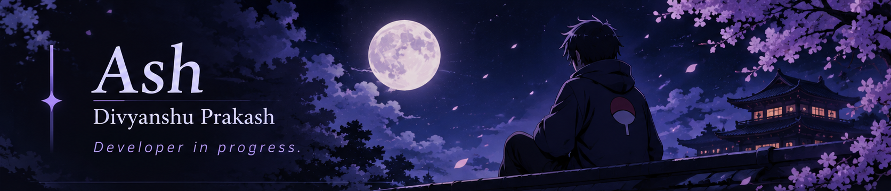

<!-- =========================================================
     ASH • GitHub Profile README
     Keep ash-anime-banner.png in the repository root.
     ========================================================= -->

 

 

## ☾  About Me

Hey! I'm **Divyanshu Prakash**, also known as **Ash**.

- 🎓 **Ex-Navodayan** · Currently studying at **CHS, BHU**
- 💻 Started exploring programming in **2020**
- ✨ Driven by curiosity and the desire to create things with code

I've been experimenting with different languages, tools, and technologies ever since. I enjoy understanding how things work, learning something new, and turning ideas into projects.

*「 Learn something. Build something. Repeat. 」*

## ⚔️  Tech & Tools

 

## 🌙  The Journey

| Chapter | Part of the story |
|:--|:--|
| **The beginning** | Started exploring code in 2020 |
| **The roots** | Ex-Navodayan · CHS, BHU |
| **The present** | Exploring Python, web development, Git and more |
| **The direction** | Build meaningful projects and keep improving |

## ✦  Beyond the Code

## ✧  What I'm Working Towards

**Learn continuously · Build meaningful things · Become a better developer**

One line of code, one idea, and one step at a time.

## 📊  GitHub Activity

Automatically refreshed every day · Powered by GitHub Actions

 

*“Curiosity started it. Code keeps it going.”*

**Still learning. Still exploring. ✨**

